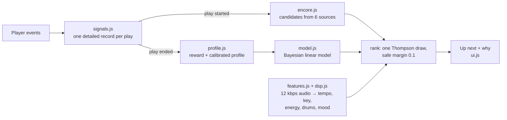

# Encore — the next-song recommender inside LYRA

Encore picks the song that plays after the one you're hearing, and gets better at it with every song. Everything runs in the browser, on your device. There is no server and no account, and no listening data leaves the phone unless you press **Export data**.

> **In one line:** an on-device contextual bandit (Bayesian linear Thompson sampling with forgetting and safe exploration). It learns from fine-grained implicit feedback: skip timing, loops, scrubbing, pauses, likes and time of day. It hears every song through in-browser audio analysis (tempo, key, energy, drums, mood).

---

## 1. How it works



1. **A song starts.** `signals.js` opens a play record. `encore.js` computes the song's feature vector *x* from that moment (previous song, session, time of day, your profile) and queues the song for audio analysis.
2. **About 2.5 s in**, Encore gathers about 40–90 candidates from six sources and filters them. It ranks them with one random draw from the model's posterior. The winner becomes **Up next**, shown under the artist with its reasons.
3. **In the background**, the top 10 candidates are analysed (about 440 KB each). Each finished analysis re-ranks with the *same* random draw, so the pick only changes when there's new information, never by chance.
4. **The song ends** (finished, skipped, back, picked another, paused for 20 min, or the app closed). The record becomes a reward, the profile updates, and the model updates with (*x*, reward). The very next decision already uses what was learned.

## 2. What it measures about you

Every play stores these fields (see the header of `js/encore/profile.js`):

| Signal | How it's measured | Why it matters |
|---|---|---|
| Seconds heard | Position deltas every 500 ms; buffering and seeks don't count | The core signal: skipping at 4 s means something very different from skipping at 2 minutes |
| How it ended | ended / next / prev / picked another / idle 20 min / app closed / error | A long pause or closing the app is not a skip |
| Restarts (loops) | A jump back to 0 from more than 8 s in, *and you stay ≥ 5 s* | The strongest "I love this" (a Previous double-tap is not a loop) |
| Replays | Going back to a song from earlier in the session, *and staying ≥ 20 s* | Same |
| Scrubbing | Forward in the first 30 s (skipping the intro) / back (hearing a part again) | Intro patience; a part worth hearing twice |
| Pauses | Count and length; a natural end is not a pause | Interruptions vs dislike |
| Volume | Start, min, max, end | Turning it up = into it; near-mute = soft skip |
| Like / playlist add *during* the song | Library changes while it plays | Explicit love, tied to the moment |
| Background seconds | Heard while the app was hidden | Passive vs active listening |
| Context | Local hour, weekday, five time blocks, phone or desktop | "Sad music at 3 AM" |
| Session | New after 30 min of silence; survives reloads | Mood and energy flow within a session |

If the phone kills the app, the open play is saved on `pagehide` and finished as "close" on the next visit.

## 3. The reward

The plan's reward table, made continuous and calibrated to you:

| What happened | Reward |
|---|---|
| Heard ≥ 90% (decided by time *heard*, so scrubbing to the end doesn't count) | +1.0 |
| Skipped under 10 s | −1.0 |
| Skipped at 10–30 s | −1.0 → −0.5 |
| Left after 30 s | −0.2 → +0.7, by how much was heard |
| Each loop/replay (max 2) | +1.5 |
| Liked while playing / un-liked | +2.0 / −1.0 |
| Added to a playlist | +1.0 |
| Went back to hear a part again | +0.3 |
| Skipped the intro, then stayed | +0.2 |
| Turned it up / turned it right down | +0.2 / −0.3 |
| Stopped listening right after a skip | −1.0 (this song ended the session) |

**Calibration:** negative parts are scaled by your skip habits (×0.6 to ×1.4). A skip means less from someone who skips 80% of songs (they're browsing) than from someone who rarely skips.

## 4. What it hears in every song (`dsp.js`)

The app decodes JioSaavn's 12 kbps stream at 11025 Hz. That stream has almost nothing above about 3.8 kHz (measured), so nothing is lost. A Web Worker then computes:

- **Rhythm:** tempo (autocorrelation of a spectral-flux onset envelope at 86 frames/s, with a log-normal prior around 120 BPM, as in librosa); pulse clarity; onset rate; **kick-drum rate** (low-band flux); a second tempo candidate for octave-safe matching.
- **Drums vs harmony:** a percussive share from median-filter HPSS (Fitzgerald 2010) on three 15-s excerpts.
- **Harmony:** a 12-bin chroma, then key and mode (Krumhansl–Schmuckler with Krumhansl–Kessler profiles), key confidence, Camelot code, and harmonic-change rate.
- **Sound:** gated loudness, dynamic range, spectral centroid, roll-off, flatness, brightness, and five band shares (sub-bass, bass, low-mid, mid, high-mid).
- **Structure:** intro length, outro start, the **first strong chorus** ("hook"), silence share, and a 32-point energy curve.
- **0–1 descriptors** (`describe()`): energy, arousal, valence, danceability, acousticness. They are interpretable heuristics from the music-emotion literature (Gabrielsson & Lindström 2010; Eerola 2011), centred with reference stats measured on 48 catalogue songs. They are designed to be replaced by a trained model without touching the recommender.

**Cost:** median 1.5 s of analysis per song on one desktop core (max 5 s), off the main thread. At most 80 analyses a day (about 35 MB), and none on Save-Data or 2G connections. Results are cached in `localStorage` (least recently used dropped first; 900 songs).

**Checked against librosa** on the same 46 real songs (`tools/compare_librosa.py`):

| | Agreement with librosa |
|---|---|
| Tempo, within 4% | 70% |
| Tempo, allowing ×½ / ×2 / ×⅓ / ×3 | 80% |
| Key, exact | 50% |
| Key, MIREX-weighted (fifth 0.5, relative 0.3, parallel 0.2) | 0.62 |

Most tempo disagreements are 3:2 ratios (the 6/8-vs-4/4 ambiguity common in Indian grooves). Most key misses are close relatives (E minor vs C major share six of seven notes). librosa is a reference implementation here, not ground truth.

## 5. The calibrated listener profile (`profile.js`)

All statistics fade with a 45-day half-life, so the profile follows you when your taste moves on. It tracks:

- **Listening clock:** your hours, weekdays and chronotype ("a night owl").
- **Skip style:** skip rate, how early you skip, and how harsh a skip is (feeds the reward).
- **Time-of-day taste:** the energy, mood, intensity and tempo you *keep* in each of five blocks (night, morning, afternoon, evening, late evening), weighted by how much you liked them.
- **Mood regulation:** after a sad song, do you stay sad or climb out? It's estimated as a *contrast*: the mood change of songs you kept minus that of songs you skipped. A plain average of kept songs would mostly measure what was offered (selection bias), and the contrast cancels that.
- **Transition sensitivity:** how much more you skip after a big jump in sound than after a small one.
- **Affinities** (shrunk averages, so one play can't outrank months of love): artists, languages, albums, eras, plus a memory of up to 1500 songs (plays, fast skips, loops, a playable copy for "familiar" picks).
- **Other habits:** appetite for new artists, repeat tolerance, and your sweet spots for duration and release year.

`insights()` turns all of this into the sentences in the panel.

## 6. The model (`model.js`)

- **43 interpretable features** of (you, now, the previous song, the candidate). They cover familiarity, artist, language, era, popularity and novelty; audio transitions (tempo, energy, key, mood and timbre gaps, signed steps, smooth flow); fit to your time-of-day taste; a "3 AM" calm prior (Park et al. 2019); session mood; mood lift (learned, or your setting); intro cost; and skip streaks.
- **Bayesian linear regression with Thompson sampling.** Each decision makes one draw from the posterior, so uncertain features get tried and known ones exploited.
- **Research priors (λ = 8):** sensible picks on day one. The data overrules the prior wherever they disagree.
- **Forgetting** (γ = 0.997 per update, pulled back toward the prior): it follows a listener who changes, and the precision matrix stays well-conditioned forever.
- **Safe exploration** (margin 0.1): a random draw can never pick a song more than 0.1 below the best expected reward (in the spirit of conservative bandits, Wu et al. 2016).
- **Missing audio is "typical", not "perfect".** Audio features are centred on their typical value between two random catalogue songs (measured: tempo 0.49, energy 0.49, key 0.58, …). Without this, unanalysed songs beat analysed ones by default; that bug was found in the live app and fixed.
- **Propensity logging:** every Encore pick stores how likely this policy was to choose it (32 extra draws), so exported logs support off-policy evaluation (IPS, doubly robust) later.
- **Explanations:** the features that raised a pick's expected reward the most, in plain words ("Flows smoothly from this song", "Fits your night mood"). Picks made by exploring say so: "Trying something new for you".
- **Learning weights:** Encore's own picks 1.0; songs you chose yourself 0.5, with a `userChosen` feature that absorbs the selection bias; playlist order 0.7.

## 7. Where the candidates come from

| Source | What it is |
|---|---|
| artist | This artist's top songs (plus similar artists' songs when the API knows any) |
| album | The rest of the album (for a film: the rest of the soundtrack) |
| taste | Songs by your top three artists |
| familiar | Liked songs, playlist songs and songs you play through (up to 20) |
| context | A playlist that fits the moment: your language + time of day + session mood ("hindi late night songs", "punjabi party songs", …) |
| explore | A popular pool from the app's configured playlists |

**Filters:** nothing from the last 20 songs of the session, no other version of the same song ("Ishq (Lofi)" counts as "Ishq"), nothing fast-skipped twice in the last week unless you like it, and nothing that failed to play in the last day. At most 12 songs come from one source. API results are cached (30 min to 6 h; failures for 20 min).

## 8. How it fits into the app

- **What plays next.** Your own ordered lists (Liked songs, your playlists) play in order, and Encore takes over when they end. Everything else (Search, Home, Explore, Encore's picks) gets Encore's next song. **Previous** walks back through what you actually heard, and **Next** steps forward again.
- **Before the first pick is ready** (the first ~3 s, or a slow network), Next plays the best unplayed song from the previous decision, or the next song from your last list.
- **Explore** becomes "songs for right now" (ranked by the same model, at most two per artist) once Encore has 5 plays.
- **The panel** (tap *Up next*) shows: why this song; *Not this one* (a clear no that rests the song); *After a sad song*: Learn it / Stay in the mood / Lift me up; what Encore has learned; exactly how the last song was scored; how this song sounds; Smart next on/off; Export data; Reset.
- **Files:**
  - New: `js/encore/{dsp,dsp-worker,features,signals,profile,model,encore,ui}.js`
  - Changed: `js/app.js` (next/previous/ended, Explore, boot), `js/api.js` (album, playlist search, artist; more song metadata), `js/store.js`, `js/pages.js`, `js/playlists.js`, `index.html`, `css/style.css`
- **Console:** `Encore.instance` exposes `.up`, `.decision`, `.prof`, `.insights()` and `.learnedWeights()`.

## 9. Verification

`node --test tests/` runs **42 tests**:

- **DSP (18):** FFT against a naive DFT; tempo on click tracks at 78–174 BPM; key on I–IV–V–I and i–iv–V–i in all 24 keys; drums vs pads; intro and hook detection; resampling; descriptor ordering.
- **Reward / profile / model (14):** song-version keys; the reward table (including replays you leave at once and scrubbing to the end); skip calibration; time-of-day taste; mood-regulation contrast; half-life fading; pruning; feature ranges; Thompson sampling exploring then settling; forgetting following a change of taste; propensities; stale-model rejection.
- **Signals (8):** against a fake player that behaves like the real one: skip timing with no fake restart on track switch; restarts, seeks and intro skips; a Previous double-tap; a natural end with auto-advance; pauses vs a natural end; likes and volume; sessions and replays; recovery after the app is killed.
- **End to end (2):** the simulation below.

**Synthetic listeners** (`node tools/simulate.js`). Three personas with hidden tastes: a night owl who stays sad at night, a morning runner who lifts out of sad songs, and an evening explorer who hates jarring jumps. Encore's real code plays against them for 4 weeks. Listen-through rate, averaged over 5 seeds × 3 personas, with every policy choosing from the same candidate pools:

| Policy | Week 1 | Week 2 | Week 3 | Week 4 | Fast skips, week 4 |
|---|---|---|---|---|---|
| random | 48.2% | 49.5% | 53.3% | 50.3% | 22.4% |
| most popular | 40.2% | 39.7% | 38.9% | 38.2% | 29.3% |
| same artist | 48.6% | 48.3% | 46.0% | 46.2% | 25.2% |
| Encore, frozen weights (profile still learns) | 65.7% | 72.5% | 74.2% | 74.6% | 9.2% |
| **Encore** | **70.9%** | **75.7%** | **76.8%** | **78.7%** | **8.7%** |

The profile also names each persona's mood style correctly in all 5 seeds: the night owl "stays in the mood"; the runner reads as a lifter in at least 4 of 5 seeds.

**Honest scope:** the simulator shares the model's assumptions (time-of-day taste, mood regulation, smooth transitions, familiarity). So these numbers show the machinery *can* learn those patterns from implicit feedback, not that real people behave this way. They also show where the gain comes from: most of it is the calibrated profile plus research priors, and weight learning adds about 4 points by week 4.

**Live app (tested in the browser):** the pick shown is the song that plays; an 8 s skip scores −1 with the full record logged (43-d *x*, propensity, source); a Previous double-tap goes back without a fake loop and Next steps forward again; *Not this one* updates the model and re-picks; Explore switches to Encore; the layout holds at 375 × 812.

Bugs the live test found and fixed:
- Skips were read as loops when the player switched tracks before the final reading.
- At a natural song end, the app's auto-advance ran first, so the next song was logged as a 0-second skip.
- Scrubbing to the end counted as a full listen.
- A Previous double-tap counted as a loop.
- Unanalysed songs were favoured over analysed ones (now centred).
- Day-one picks were too random (λ = 8, explore 0.25, safe margin 0.1, all tuned on the simulator).
- "Song Reprise" could follow "Song" (versions now share a title key).
- A broken API endpoint was retried on every song.

## 10. Known limits

- **Audio descriptors are heuristics, not a trained model.** Valence from audio alone is the hardest part of music emotion recognition (r ≈ 0.4–0.5 with human ratings at best).
- **No instrument tags yet.** Guitar, piano and strings need a trained tagger (CNN). Drums are covered by the percussive share and the kick rate.
- **Key detection is profile-based** (0.62 MIREX-weighted agreement with librosa).
- **Learning is per device.** There's no learning across users (no server, by design for now).
- **The synthetic results are not real-world results** (see above).

## 11. Next research steps (from the plan)

1. **Real logs.** Use it yourself and with friends, then *Export data*. You get plays with propensities, audio features and the profile, ready for offline evaluation.
2. **Off-policy evaluation:** IPS and doubly robust estimates of new policies on those logs, before shipping them.
3. **Emotion CNN** (DEAM / PMEmo, mel-spectrograms) to replace the heuristic valence/arousal in `describe()`. The interface stays the same.
4. **ListenSim in Python:** calibrate personas to the Spotify MSSD / Last.fm session statistics, then run the cross-simulator robustness study.
5. **Instrument tagger and a CNN key estimator**, offline, written into the same feature cache.

## 12. Run it

```bash
node --test tests/
```

```bash
node tools/simulate.js 28 1
```

```bash
node tools/calibrate-dsp.js <work-dir> 48
```

```bash
python tools/compare_librosa.py <work-dir>
```

(`compare_librosa.py` needs `pip install librosa` and ffmpeg on the PATH. The calibration tool downloads about 20 MB of 12 kbps audio into `<work-dir>`.)

## References

- Agrawal & Goyal (2013), *Thompson Sampling for Contextual Bandits with Linear Payoffs*
- Chapelle & Li (2011), *An Empirical Evaluation of Thompson Sampling*
- Wu, Shariff, Lattimore & Szepesvári (2016), *Conservative Bandits*
- Fitzgerald (2010), *Harmonic/Percussive Separation Using Median Filtering*
- Krumhansl (1990), *Cognitive Foundations of Musical Pitch* (key profiles)
- Gabrielsson & Lindström (2010), *The role of structure in the musical expression of emotions*
- Eerola (2011), *Are the emotions expressed in music genre-specific?*
- Park et al. (2019), *Global music streaming data reveal diurnal and seasonal patterns of affective preference*, Nature Human Behaviour
- Heggli et al. (2021), *Diurnal fluctuations in musical preference*, Royal Society Open Science
- Tomasi et al. (2023), *Automatic Music Playlist Generation via Simulation-based Reinforcement Learning*, KDD (Spotify)
